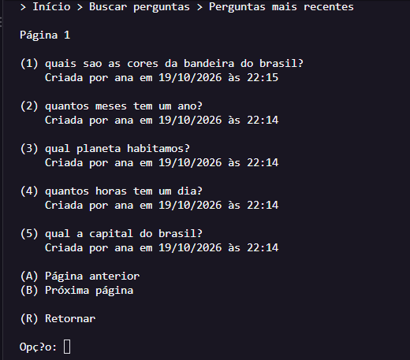
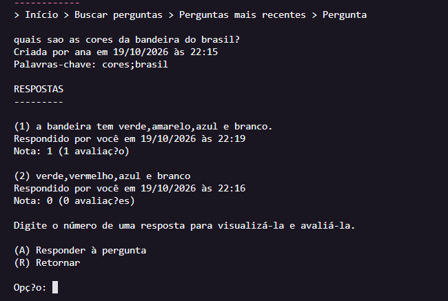
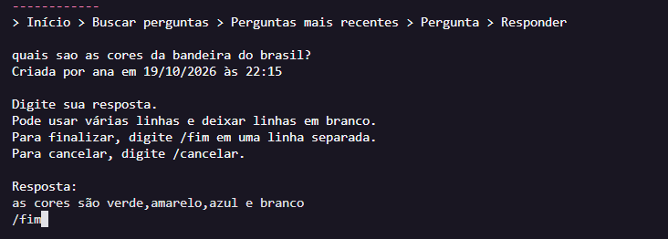
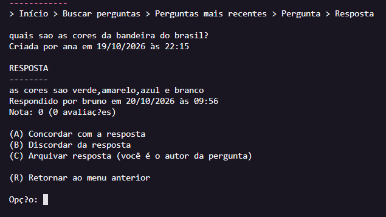

# Ajuda Aí 1.0

Trabalho prático 2 — Relacionamento N:N  
Disciplina de Algoritmos e Estruturas de Dados III (AEDs III) da PUC Minas.

## Integrantes

- Arthur Soares Rolla
- Gabriel Lucas Santos Moura
- Lucas Santiago Pereira
- Matheus Arantes Coimbra

## Apresentação — Parte 2

O Ajuda Aí é um sistema de perguntas e respostas desenvolvido em Java, com interface textual no terminal e armazenamento em arquivos binários. O projeto utiliza um CRUD genérico, tabelas hash extensíveis e árvores B+.

Esta etapa amplia o trabalho desenvolvido no TP1, acrescentando a consulta de perguntas recentes, o cadastro de respostas e o gerenciamento de avaliações. O relacionamento N:N entre usuários e perguntas é representado pela entidade Resposta, que identifica o usuário que respondeu e a pergunta correspondente.

## Como compilar e executar

Certifique-se de que tem o Java (JDK) instalado. Abra o terminal na pasta onde está o ficheiro `Principal.java` e digite os seguintes comandos:

1. **Compilar o código:**
   ```bash
   javac -encoding UTF-8 Principal.java
   java Principal
  ```


## Estrutura do projeto

### Índice de perguntas por data

A classe `ArquivoPergunta` recebeu uma árvore B+ com entradas da classe `ParDataId`, que armazena a data de criação e o ID da pergunta. Esse índice permite consultar as perguntas ativas da mais recente para a mais antiga.

### Respostas

A classe `Resposta` contém os IDs da resposta, da pergunta e do usuário, além de data de criação, texto, nota, quantidade de avaliações e estado de atividade.

A classe `ArquivoResposta` estende `Arquivo<Resposta>` e gerencia sua persistência. Duas árvores B+ armazenam os pares `(idUsuario, idResposta)` e `(idPergunta, idResposta)`, permitindo consultar respostas por usuário e por pergunta.

### Avaliações

A classe `Avaliacao` contém os IDs da avaliação, do usuário e da resposta, além da indicação de avaliação positiva ou negativa.

A classe `ArquivoAvaliacao` estende `Arquivo<Avaliacao>` e mantém duas árvores B+ com os pares `(idUsuario, idAvaliacao)` e `(idResposta, idAvaliacao)`. Também utiliza `ArquivoResposta` para ajustar a nota e a quantidade de avaliações.

As entidades `Resposta` e `Avaliacao` implementam `InterfaceRegistro`, com os métodos `serialize()` e `deserialize()` para armazenamento em arquivos binários.

### Interface e controles

A interface textual é organizada pelas classes `ControleUsuario`, `ControlePergunta` e `ControleResposta`. O `ControleUsuario` mantém o usuário autenticado e permite acessar os menus da área pessoal. O `ControlePergunta` organiza a busca paginada, a consulta das próprias perguntas e a visualização das respostas recebidas.

O `ControleResposta` reúne as telas de cadastro e visualização de respostas, arquivamento, avaliação e cancelamento de avaliações. Também apresenta as opções “Minhas respostas” e “Minhas avaliações”, utilizando os métodos dos respectivos arquivos.

A classe `Principal` inicializa os arquivos e conecta os controles. A classe `Utilidades` reúne funções de apresentação, formatação de datas e tratamento de entradas numéricas.

## Funcionalidades implementadas

### Busca de perguntas recentes

A busca utiliza uma árvore B+ que organiza as perguntas ativas em ordem decrescente de data de criação. Os resultados são apresentados em páginas de cinco perguntas, com opções para avançar e retornar. Cada pergunta aparece com seu texto, nome do autor e data de criação, sendo selecionada por um número da listagem, sem expor o ID interno. A opção de busca por palavras-chave aparece no menu, mas não é implementada nesta etapa, conforme o enunciado.

### Visualização da pergunta e de suas respostas

Ao selecionar uma pergunta na busca, o usuário visualiza seu texto, autor, data de criação e palavras-chave, além das respostas ativas associadas a ela. As respostas são consultadas pelo relacionamento em árvore B+ e apresentadas em ordem decrescente de nota. Cada resposta mostra o nome de quem a escreveu, a data, a nota e a quantidade de avaliações recebidas.

### Cadastro de respostas

Na tela de responder, a pergunta é reapresentada para que o usuário saiba a qual conteúdo está respondendo. O texto pode conter várias linhas e parágrafos, utilizando `/fim` para concluir ou `/cancelar` para retornar sem gravar. O sistema associa a resposta à pergunta selecionada e ao usuário autenticado, gera seu ID e define automaticamente a data, a nota inicial zero, a quantidade de avaliações zero e o estado ativo. Antes da gravação, o CRUD verifica se o usuário e a pergunta existem, se a pergunta está ativa e se o texto foi preenchido.

### Arquivamento de respostas

O CRUD permite que uma resposta seja arquivada por seu próprio autor ou pelo autor da pergunta à qual ela pertence. A operação altera o estado da resposta para inativa, mantendo o registro e seus vínculos armazenados, mas retirando-a das listagens por pergunta e por usuário. A alteração direta do texto e a exclusão direta são bloqueadas; para corrigir uma resposta, o usuário deve arquivá-la e cadastrar outra.O arquivamento está disponível no detalhe da resposta, com confirmação antes da operação. O autor pode acessar suas respostas pela opção “Minhas respostas”, enquanto o autor da pergunta pode gerenciar as respostas recebidas em “Minhas perguntas”.

### Integridade dos relacionamentos

As respostas mantêm vínculos com seus usuários e perguntas por meio de duas árvores B+, enquanto as avaliações possuem índices por usuário e por resposta. Na exclusão interna de um usuário, suas avaliações são canceladas, revertendo os efeitos nas notas e nos contadores das respostas preservadas. Também são removidas suas respostas, suas perguntas e as respostas recebidas nessas perguntas, incluindo as arquivadas, com a limpeza das avaliações e dos índices correspondentes. O arquivamento, por sua vez, mantém os registros e seus relacionamentos.

### Avaliação e cancelamento de avaliações

Ao visualizar uma resposta de outro usuário, é possível concordar ou discordar dela. Uma avaliação positiva acrescenta um ponto à nota, enquanto uma negativa retira um ponto; nos dois casos, a quantidade de avaliações aumenta em uma unidade. Após votar, a interface informa a avaliação realizada e não oferece uma nova votação na mesma resposta.

O cancelamento é realizado em “Minhas avaliações”, mediante confirmação. A operação remove a avaliação e desfaz seu efeito na nota e na quantidade de avaliações da resposta. Para avaliar novamente, o usuário deve retornar à resposta e registrar um novo voto.

### Gestão pela área pessoal

Em “Minhas respostas”, o usuário consulta suas respostas ativas e pode selecionar uma delas para visualizar o texto completo, a pergunta correspondente e a opção de arquivamento. Em “Minhas avaliações”, são apresentadas suas avaliações associadas a respostas ativas, permitindo consultar o voto realizado e cancelá-lo.

A opção “Minhas perguntas” permite selecionar uma pergunta própria e visualizar as respostas recebidas, ordenadas por nota. Além de alterar ou arquivar a pergunta, seu autor pode abrir uma resposta recebida e arquivá-la, mediante confirmação.

## Telas do sistema

### Busca de perguntas recentes

Listagem das perguntas ativas em ordem decrescente de data de criação, com cinco perguntas por página e opções de navegação.



A página seguinte apresenta a continuação dos resultados.


### Pergunta e respostas

Detalhe de uma pergunta, com as respostas ativas ordenadas por nota, identificação dos autores e quantidade de avaliações.



### Cadastro de resposta

Tela de inclusão de uma resposta, mantendo a pergunta visível e permitindo escrever várias linhas de texto.



### Visualização e avaliação de uma resposta

Ao abrir uma resposta de outro usuário, são apresentadas as opções de concordar ou discordar.



### Minhas respostas

Na área pessoal, o usuário consulta as respostas que escreveu.


Ao selecionar uma resposta própria, visualiza a pergunta correspondente e a opção de arquivamento.


### Minhas avaliações

A área pessoal apresenta as respostas avaliadas pelo usuário.


O detalhe mostra a pergunta, a resposta e a avaliação realizada, com a opção de cancelar a avaliação.


### Respostas recebidas em minhas perguntas

Ao abrir uma pergunta própria, o usuário visualiza as respostas recebidas e as opções de alterar ou arquivar a pergunta.


O autor da pergunta também pode selecionar e arquivar uma resposta recebida.


## Checklist

- Há uma listagem paginada de perguntas, que mostra as perguntas em ordem decrescente de data a partir de uma Árvore B+ acrescentada ao CRUD de Perguntas?

  ```SIM```

- Há uma listagem das respostas a uma pergunta selecionada, em ordem decrescente de nota?

  ```SIM```

- O usuário pode responder a uma pergunta?

  ```SIM```

- O usuário pode arquivar a própria resposta?

  ```SIM```

- O usuário pode avaliar uma resposta?

  ```SIM```

- Na área do usuário, o usuário pode visualizar as respostas às suas perguntas?

  ```SIM```

- Na área do usuário, o usuário pode arquivar uma resposta de outro usuário a uma das suas perguntas?

  ```SIM```

- Na área do usuário, o usuário pode visualizar e arquivar as respostas que escreveu?

  ```SIM```

- Na área do usuário, o usuário pode visualizar e arquivar a avaliação que realizou em uma resposta?

  ```SIM```

- A integridade do relacionamento entre perguntas e respostas está mantida em todas as operações?

  ```Pendente da conclusão da revisão```

- A integridade do relacionamento entre respostas e avaliações está mantida em todas as operações?

  ```NÃO, enquanto persistirem as falhas conhecidas```

- O trabalho compila corretamente?

  ```SIM```

- O trabalho está completo e funcionando sem erros de execução?

  ```NÃO, ainda existem pendências```

- O trabalho é original e não a cópia de um trabalho de outro grupo?

  ```SIM```

### Vídeo de Demonstração
  - **Link do Youtube**: 
