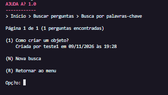
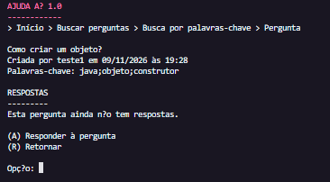
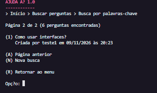

# Ajuda Aí 2.0

Trabalho prático 3 — Índice invertido e busca por palavras-chave
Disciplina de Algoritmos e Estruturas de Dados III (AEDs III) da PUC Minas.

## Integrantes

- Arthur Soares Rolla
- Gabriel Lucas Santos Moura
- Lucas Santiago Pereira
- Matheus Arantes Coimbra

## Apresentação — Parte 3

O Ajuda Aí é um sistema de perguntas e respostas desenvolvido em Java, com interface textual no terminal e armazenamento em arquivos binários. O projeto utiliza um CRUD genérico, tabelas hash extensíveis e árvores B+ para gerenciar usuários, perguntas, respostas e avaliações.

O TP3 acrescenta a busca de perguntas pelos termos presentes no atributo de palavras-chave. Para isso, utiliza um índice invertido que associa cada termo às perguntas em que aparece. Os resultados são classificados pelo modelo TF×IDF, permitindo apresentar primeiro as perguntas com maior pontuação para a consulta.

## Como compilar e executar

Certifique-se de que tem o Java (JDK) instalado. Abra o terminal na pasta onde está o ficheiro `Principal.java` e digite os seguintes comandos:

1. **Compilar o código:**
   ```bash
   javac -encoding UTF-8 Principal.java
   java Principal
   ```


## Estrutura do projeto

### Tratamento dos termos

A classe TratamentoTermo concentra o processamento das palavras-chave e das consultas. O texto é convertido para letras minúsculas, os acentos são removidos e os termos são separados pelos delimitadores, incluindo espaços e ponto e vírgula. Em seguida, são descartadas as palavras presentes na lista de stop words, como artigos e preposições.

As repetições dos termos nas palavras-chave são preservadas para o cálculo de suas frequências. A indexação e a consulta utilizam o mesmo tratamento, permitindo, por exemplo, que uma busca por “INTELIGENCIA” encontre o termo cadastrado como “inteligência”.

### Índice invertido

A classe IndicePerguntas gerencia a indexação das palavras-chave. Para cada termo, a classe ListaInvertida mantém uma lista de elementos representados por ElementoLista, contendo o ID da pergunta e a frequência relativa do termo.

Uma árvore B+ adicional registra os IDs das perguntas indexadas, utilizando pares da classe ParIdId. Esse controle evita que a mesma pergunta seja incluída novamente no índice e contabilizada mais de uma vez ao reiniciar o programa.

### Cálculo do TF

O TF representa a proporção de ocorrências de um termo entre as palavras válidas de uma pergunta:

TF = ocorrências do termo / total de termos válidos nas palavras-chave

Por exemplo, se um termo aparece duas vezes em um conjunto de cinco palavras válidas, seu TF é 0,4. As ocorrências são agrupadas antes da gravação, mantendo uma única entrada por termo e pergunta.

### Busca e classificação por TF×IDF

O método IndicePerguntas.buscar() processa a consulta e recupera a lista de perguntas associadas a cada termo. Termos repetidos na consulta são considerados uma única vez.

Para cada termo encontrado, calcula-se o IDF:
IDF = log10(N / quantidade de perguntas que contêm o termo)

N representa o total de perguntas indexadas. A contribuição de cada termo para uma pergunta é obtida multiplicando seu TF pelo IDF. As contribuições são somadas por ID de pergunta, formando uma pontuação final.

A busca inclui perguntas que contenham pelo menos um dos termos pesquisados. Os resultados são ordenados por pontuação decrescente; em caso de empate, utiliza-se o ID da pergunta em ordem crescente como critério interno de desempate.

A classe interna IndicePerguntas.Resultado representa o ID e a pontuação calculada. O método ArquivoPergunta.buscarPorPalavrasChave() recupera os registros correspondentes, preserva a ordem do ranking e retorna apenas perguntas existentes e ativas.

### Integração com o CRUD

A classe `ArquivoPergunta` atualiza o índice invertido nas operações de cadastro, alteração, arquivamento e exclusão interna de perguntas. No cadastro, os termos de uma pergunta ativa são indexados. Na alteração das palavras-chave, os vínculos antigos são removidos e os novos termos são incluídos. No arquivamento e na exclusão, os vínculos da pergunta são retirados do índice.

A contagem utilizada no IDF é ajustada na inclusão e na remoção de perguntas. A alteração de palavras-chave mantém essa contagem. Ao abrir o arquivo de perguntas, o sistema inclui no índice as perguntas ativas existentes que ainda não estejam indexadas.

## Funcionalidades implementadas

### Busca de perguntas recentes

A busca utiliza uma árvore B+ que organiza as perguntas ativas em ordem decrescente de data de criação. Os resultados são apresentados em páginas de cinco perguntas, com opções para avançar e retornar. Cada pergunta aparece com seu texto, nome do autor e data de criação, sendo selecionada por um número da listagem, sem expor o ID interno.

### Visualização da pergunta e de suas respostas

Ao selecionar uma pergunta na busca, o usuário visualiza seu texto, autor, data de criação e palavras-chave, além das respostas ativas associadas a ela. As respostas são consultadas pelo relacionamento em árvore B+ e apresentadas em ordem decrescente de nota. Cada resposta mostra o nome de quem a escreveu, a data, a nota e a quantidade de avaliações recebidas.

### Cadastro de respostas

Na tela de responder, a pergunta é reapresentada para que o usuário saiba a qual conteúdo está respondendo. O texto pode conter várias linhas e parágrafos, utilizando `/fim` para concluir ou `/cancelar` para retornar sem gravar. O sistema associa a resposta à pergunta selecionada e ao usuário autenticado, gera seu ID e define automaticamente a data, a nota inicial zero, a quantidade de avaliações zero e o estado ativo. Antes da gravação, o CRUD verifica se o usuário e a pergunta existem, se a pergunta está ativa e se o texto foi preenchido.

### Arquivamento de respostas

O CRUD permite que uma resposta seja arquivada por seu próprio autor ou pelo autor da pergunta à qual ela pertence. A operação altera o estado da resposta para inativa, mantendo o registro e seus vínculos armazenados, mas retirando-a das listagens por pergunta e por usuário. A alteração direta do texto e a exclusão direta são bloqueadas; para corrigir uma resposta, o usuário deve arquivá-la e cadastrar outra.O arquivamento está disponível no detalhe da resposta, com confirmação antes da operação. O autor pode acessar suas respostas pela opção “Minhas respostas”, enquanto o autor da pergunta pode gerenciar as respostas recebidas em “Minhas perguntas”.

### Integridade dos relacionamentos

As respostas mantêm vínculos com seus usuários e perguntas por meio de duas árvores B+, enquanto as avaliações possuem índices por usuário e por resposta. Na exclusão interna de um usuário, suas avaliações são canceladas, revertendo os efeitos nas notas e nos contadores das respostas preservadas. Também são removidas suas respostas, suas perguntas e as respostas recebidas nessas perguntas, incluindo as arquivadas, com a limpeza das avaliações e dos índices correspondentes. O arquivamento, por sua vez, mantém os registros e seus relacionamentos.

### Avaliação e cancelamento de avaliações

Ao visualizar uma resposta de outro usuário, é possível concordar ou discordar dela. Uma avaliação positiva acrescenta um ponto à nota, enquanto uma negativa retira um ponto; nos dois casos, a quantidade de avaliações aumenta em uma unidade. Após votar, a interface informa a avaliação realizada e não oferece uma nova votação na mesma resposta.

O cancelamento é realizado em “Minhas avaliações”, mediante confirmação. A operação remove a avaliação e desfaz seu efeito na nota e na quantidade de avaliações da resposta. Para avaliar novamente, o usuário deve retornar à resposta e registrar um novo voto.

### Gestão pela área pessoal

Em “Minhas respostas”, o usuário consulta suas respostas ativas e pode selecionar uma delas para visualizar o texto completo, a pergunta correspondente e a opção de arquivamento. Em “Minhas avaliações”, são apresentadas suas avaliações associadas a respostas ativas, permitindo consultar o voto realizado e cancelá-lo.

A opção “Minhas perguntas” permite selecionar uma pergunta própria e visualizar as respostas recebidas, ordenadas por nota. Além de alterar ou arquivar a pergunta, seu autor pode abrir uma resposta recebida e arquivá-la, mediante confirmação.

### Busca de perguntas por palavras-chave

A opção “Busca por palavras-chave”, disponível no menu “Buscar perguntas”, permite informar um ou mais termos. A consulta utiliza o índice invertido construído a partir das palavras-chave cadastradas nas perguntas.

O tratamento dos termos desconsidera diferenças entre letras maiúsculas e minúsculas e remove acentos, stop words e termos compostos somente por números. Uma consulta vazia retorna ao menu anterior.

As perguntas ativas que contêm pelo menos um dos termos pesquisados são apresentadas em ordem decrescente de pontuação TF×IDF. Os resultados são exibidos em páginas de cinco perguntas, com texto, autor e data de criação.

O usuário pode navegar entre as páginas, realizar uma nova busca ou selecionar uma pergunta para visualizar suas respostas, responder ou avaliar uma resposta de outro usuário. Quando não existem resultados, o sistema apresenta uma mensagem e permite informar outra consulta.

### Atualização das palavras-chave e arquivamento

Ao alterar as palavras-chave de uma pergunta, o sistema remove seus vínculos com os termos antigos e inclui os novos termos no índice. As buscas seguintes passam a considerar as palavras-chave atualizadas.

Perguntas arquivadas deixam de aparecer nos resultados. As alterações permanecem após reiniciar o programa, e perguntas ativas já existentes são indexadas automaticamente quando ainda não constam no índice.

## Telas do sistema

### Busca por palavras-chave

Resultado da busca por palavras-chave, com identificação do autor e data de criação da pergunta. A tela permite selecionar uma pergunta, realizar uma nova busca ou retornar ao menu.



### Detalhe da pergunta encontrada

Ao selecionar um resultado, o usuário visualiza a pergunta, suas palavras-chave e as respostas disponíveis. Também pode responder à pergunta ou retornar à listagem.



### Paginação dos resultados

Os resultados são apresentados em páginas de até cinco perguntas, preservando a ordem de relevância calculada pelo TF×IDF. A imagem mostra a segunda página de uma busca com seis resultados.



## Checklist

- O índice invertido com palavras-chave foi criado usando a classe ListaInvertida?

  **SIM.**

- É possível buscar perguntas por palavras-chave no menu de buscar perguntas?

  **SIM.**

- As perguntas retornadas estão corretamente classificadas pelo modelo TFxIDF?

  **SIM.**

- O trabalho compila corretamente?

  **SIM.**

- O trabalho está completo e funcionando sem erros de execução?

  **SIM, considerando as funcionalidades implementadas e os testes realizados pelo grupo.**

- O trabalho é original e não a cópia de um trabalho de outro grupo?

  **SIM.**

### Vídeo de Demonstração
  - **Link do Youtube**: 
